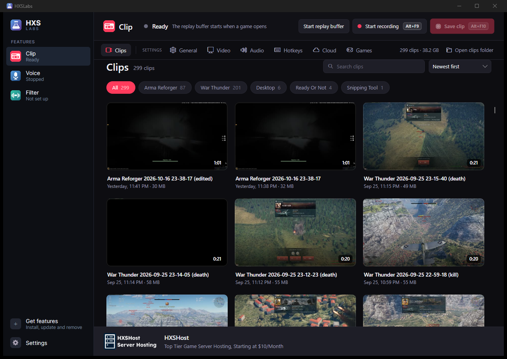
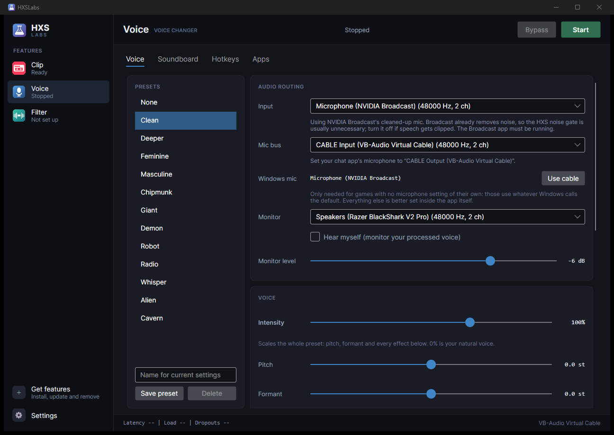
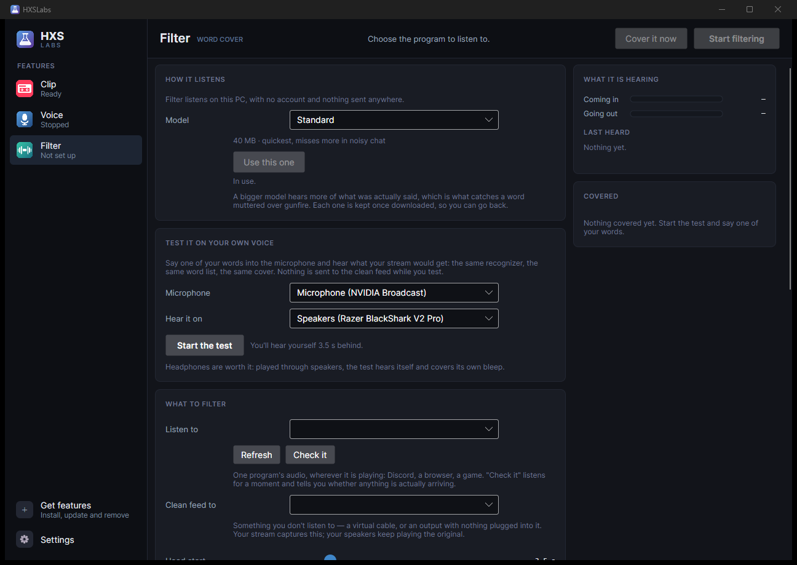
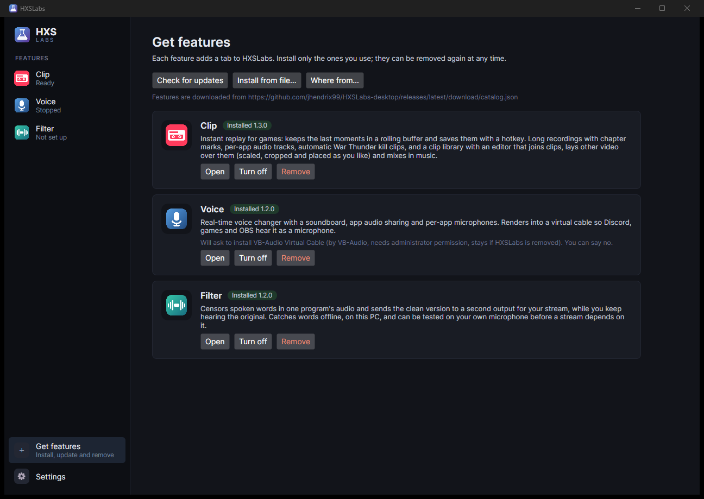

# HXSLabs

One app for the HXS tools, for Windows. The app itself is small; each feature installs separately
from inside it, so you only download the ones you want.

**[Download HXSLabs](https://github.com/jhendrix99/HXSLabs-desktop/releases/latest/download/HXSLabs-win-x64.zip)**
· version 1.2.0 · 47 MB · Windows 10 version 2004 or newer, 64-bit · no .NET install needed

Unzip it anywhere and run `HXSLabs.exe`. It needs no administrator rights and no installer. Open
**Get features** and pick what you want.

## The features

| | |
|---|---|
| **Clip** | Instant replay for games: keeps the last moments in a rolling buffer and saves them with a hotkey. Long recordings with chapter marks, per-app audio tracks, automatic War Thunder kill clips, and a clip library with an editor that joins clips, lays other video over them (scaled and cropped as you like) and mixes in music. Carries its own ffmpeg, so it is the big one at 76 MB. |
| **Voice** | Real-time voice changer with a soundboard, app audio sharing and per-app microphones. Renders into a virtual cable so Discord, games and OBS hear it as a microphone. Windows has no way for a program to appear as a microphone on its own, so Voice offers to install VB-Audio Virtual Cable — it tells you what that is before anything is downloaded, and does nothing if you say no. |
| **Filter** | Censors spoken words in one program's audio and sends the clean version to a second output for your stream, while you keep hearing the original. Recognition runs offline on your own PC — nothing is uploaded — and you can test it on your own microphone before a stream depends on it. |

Each feature keeps its settings in `%LOCALAPPDATA%\HXSLabs\data\`, which survives updates and
uninstalls, so turning one off and back on loses nothing.

## What it looks like


*Clip — the library, grouped by game, with everything the replay buffer caught.*


*Voice — presets down the side, and the routing that makes Discord hear it as a microphone.*


*Filter — try it on your own voice before a stream depends on it.*


*Features install from inside the app, and come off again just as easily.*

## Windows will warn you about the download

HXSLabs is not code-signed, so SmartScreen shows *"Windows protected your PC"* the first time, and
the publisher reads as unknown. A signature is a paid subscription, and this is free software.
Choose **More info** then **Run anyway**.

It asks for no administrator rights, so there is no second prompt after that one.

What is published instead of a signature is the download's checksum. To confirm you have what was
actually built, compare it against
[`HXSLabs-win-x64.zip.sha256`](https://github.com/jhendrix99/HXSLabs-desktop/releases/latest/download/HXSLabs-win-x64.zip.sha256)
in the release:

```powershell
(Get-FileHash .\HXSLabs-win-x64.zip -Algorithm SHA256).Hash
```

Features are checked for you: every package in the catalog carries its SHA-256, and a download
that doesn't match is thrown away rather than installed.

## Updating

The app checks for newer features by itself and applies them at the next start. To update the app,
download it again and unzip it over the old copy — your settings and installed features live
elsewhere and are untouched.

## Privacy

Nothing you record, say or filter leaves your PC. Speech recognition in Filter runs locally on a
model downloaded once. The app fetches two things from the internet and nothing else: the feature
catalog in this repository, and the promo banner feed.
